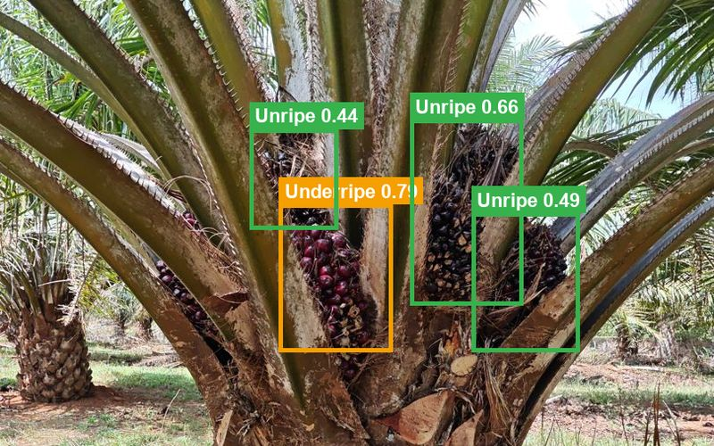

# sawit-vision-api

Detects oil palm fresh fruit bunches in a photo and labels each one `Ripe`, `Underripe`, `Unripe`, `Flower` or `Abnormal`.
A YOLOv8n model I trained during my research work, exported to ONNX and served with FastAPI. Every request is logged to SQLite.

The same model also runs in the browser on my site: https://muhammad-zainal-muttaqin.github.io/#demo



## Model

| | |
|---|---|
| Architecture | YOLOv8n, 640 px input, 300 epochs |
| Validation precision / recall | 0.783 / 0.716 |
| Validation mAP@50 / mAP@50-95 | 0.771 / 0.496 |
| Size | 6.3 MB `.pt`, 11.7 MB `.onnx` |

Inference does not need PyTorch. Letterbox pre-processing and NMS are in NumPy ([`app/detector.py`](app/detector.py)), so the runtime only needs `onnxruntime`, `numpy` and `Pillow`.

## Speed

One 476×636 photo, Apple M1 (8 GB), median of 50 runs including pre/post-processing (`python scripts/benchmark.py IMAGE`):

| Runtime | Median | p95 |
|---|---|---|
| ONNX Runtime + CoreML | 23 ms | 31 ms |
| PyTorch (Ultralytics), CPU | 88 ms | 115 ms |
| ONNX Runtime, CPU only | 166 ms | 201 ms |

The CPU-only number was measured while the laptop was under other load.

## Field test

I ran the model on 568 new phone photos (71 trees × 8 sides, Damimas block, Nov 2026) that were not used in training
(`scripts/predict_folder.py`). Those photos have no labels yet, so this is a qualitative check, not an mAP:

- 691 boxes in detection-only mode, median 6 ms per photo with CoreML.
- Bunches in the crown that are found are usually correct.
- Weak points: about a third of the boxes fall on ground, dry fronds or trees in the background, and small bunches in photos taken from far away are often missed. The training photos were closer to the crown.

Next step is to label a subset of these photos and fine-tune on them.

## API

| Method | Path | |
|---|---|---|
| `POST` | `/detect?conf=0.25&iou=0.45&agnostic=false` | Multipart `file`. Returns boxes, labels, confidence, count per class and latency. `agnostic=true` gives detection only (every box is `Bunch`) |
| `GET` | `/history?limit=20` | Latest requests from the SQLite log |
| `GET` | `/stats` | Request count, objects per class, median latency |
| `GET` | `/health` | Model file, execution provider, class names |
| `GET` | `/` | Upload page that draws the boxes |
| `GET` | `/docs` | Swagger UI |

```bash
curl -F "file=@samples/palm-2.jpg" "http://localhost:8000/detect?conf=0.3"
# response (only the first of the 3 detections shown)
```

```json
{
  "id": 2,
  "image": {"width": 810, "height": 1080},
  "count": 3,
  "counts": {"Unripe": 2, "Ripe": 1},
  "latency_ms": 7.5,
  "detections": [{"label": "Unripe", "confidence": 0.7612, "box": [283.4, 332.0, 410.2, 448.0]}]
}
```

## Run

```bash
python -m venv .venv && source .venv/bin/activate
pip install -r requirements.txt
uvicorn app.main:app --port 8000
```

Docker (`DB_PATH` points to the `/data` volume):

```bash
docker build -t sawit-vision-api .
docker run -p 8000:8000 -v sawit-data:/data sawit-vision-api
```

Tests (7, including two on real field photos in `samples/`):

```bash
pip install -r requirements.txt pytest httpx
pytest -q
```

After retraining, re-export with `python scripts/export_onnx.py` (needs `ultralytics`).

## Notes

- The model was trained with Ultralytics YOLOv8, which is AGPL-3.0.
- Sample photos in `samples/` are field captures from the Damimas block, shared with permission.
